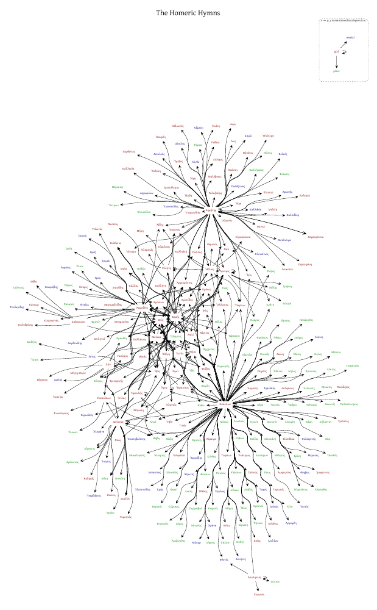

# Hymnoi

*Ὕμνοι*: a graph of every god, mortal and place named in the Homeric Hymns.

Peter Danenberg compiled it by hand in 2009: one edge for each name in each
hymn. He printed it as a poster, meant to sell it online, and gave copies to
friends when they moved from Tyrella Ave to Colorado Pl. It never went on the
web. This repo holds the 2009 graph, the 2020 render of the poster, and the
rebuild that started in October 2026: the data checked line by line against
the Greek, with a citation for every mention, and the d3 views and site built
on it.



## History

| When | What |
|---|---|
| 2006 | hymnoi.com and hymnoi.org registered. |
| 2009-12-31 | `hymnoi.dot` written by hand and laid out with Graphviz `fdp`. The source for the attributions was the index of names at the back of a Loeb edition. Printed as a poster at Kinko's (`size="58!"`, roughly 36 × 59 in). |
| 2013-02-02 | Pushed to GitHub as "first pass sans history"; the commit carries the 2009 date. |
| 2020-09-06/07 | `hymnoi.dot` restyled (title at the top, dotted legend, `dpi=600`) and rendered to `hymnoi.pdf`. Same data as 2009. Kept on Drive under `glaptop4/prg/hymnoi`. |
| 2026-10 | Rebuild begins: this README, `legacy/`, `data/`, `tools/`. |

## Layout

```
README.md                  this file
REVIEW.md                  the judgement calls still open, with the defaults the views apply
legacy/2009/hymnoi.dot     the graph as written in 2009 (git history intact)
legacy/2009/TODO           "png with image map; need links to all places, people, gods"
legacy/2020/hymnoi.dot     the 2020 restyle (same nodes and edges)
legacy/2020/hymnoi.pdf     the poster render, vector; scales to any print size
legacy/2020/hymnoi.dot.png an abandoned render with `dot` instead of `fdp`
legacy/2020/hymnoi-preview.png
data/text/greek.tsv        the Greek, one row per line (hymn, line, text, note)
data/text/english.tsv      Evelyn-White's English, one row per paragraph
data/hymns.csv             the 34 hymns: numerals, titles, dedicatees, length
data/entities.csv          286 beings, groups and places: kind, subkind, Greek and English names
data/mentions.csv          1,399 mentions: hymn, line, form, lemma, entity, type, certainty, note
data/extract/              the extraction as nine workers delivered it, and its method (SPEC.md)
data/legacy/               the 2009 graph as CSV, its node-to-entity map, and the audit
site/                      the d3 views (static; data/hymnoi.json is built)
tools/                     the scripts that produce all of the above
docs/                      screenshots
```

To rebuild and look:

```
tools/import_text.py      # data/text from ~/prg/canon (+ fixes)
tools/merge_extract.py    # data/{mentions,entities,hymns}.csv from data/extract (once; --force to redo)
tools/audit_legacy.py     # data/legacy/{node_map,audit,new}.csv
tools/build.py            # site/data/hymnoi.json
python3 -m http.server 8765 --directory site   # then http://localhost:8765/
```

The 2009 files are kept in a folder rather than left in git history: the
rebuild audits every 2009 edge against the text, and the site will show the
poster's history, so both need the originals on hand.

## The 2009 graph

### What an edge means

The header of `hymnoi.dot` says it: `x -> y` means "*y* is mentioned in a hymn
dedicated to *x*". Line width was meant to count how many of *x*'s hymns
mention *y*.

### Counts

- **289 nodes**, all labelled in Greek, coloured by kind:
  126 *theoi* (gods, red), 50 *anthropoi* (mortals, blue), 113 *chthones*
  (places, green).
- **433 edge statements**, 429 distinct (Κύπρος, Αἴγυπτος and Νύση are each
  listed twice). The ".dot has 439 edges" count you get from grep also includes
  the three legend edges and three commented-out ones.
- **23 sources**: Ἀπόλλων 150, Δημήτηρ 73, Ἀφροδίτη 43, Ἑρμῆς 36,
  Διόνυσος 24, Ἄρτεμις 11, Ἀθήνη 11, Ἠέλιος 10, Ἑστίη 9, Πᾶν 9, Διόσκουροι 8,
  Ἡρακλῆς 8, Σελήνη 7, Ἀσκληπιός 5, Ἥρη 5, Ἄρης 4, Ποσειδάων 4, Ξένος 4,
  Ἥφαιστος 3, Μοῦσαι 3, Ζεύς 3, Γαῖα 2, Μήτηρ Θεῶν 1.
- Most-mentioned targets: Zeus 17, the Muses 11, Olympos 9, Apollo 8, Hera 6,
  Κρονίων 6. 223 of the 289 nodes have a single edge: names that occur in
  one hymn only.

### Known problems

These are what the rebuild fixes. None is a reason to change the 2009 file
itself, which stays as it was.

1. **A hymn is folded into its god.** There are 33 hymns but 22 dedicatees:
   "aphrodite" stands for Hymns 5, 6 and 10, "dionusos" for 1, 7 and 26,
   "apollon" for 3 and 21, and so on. The god as a *source* (the hymn) and the
   god as a *target* (a mention) are the same node, which is the ambiguity the
   2009 header comment worries about, and it produces 18 self-loops.
2. **A node is a name, not a being.** Apollo is eight nodes (Ἀπόλλων, Φοῖβος,
   Ἑκάεργος, Πύθιος, Δελφίνιος, Λητοΐδης, Ἑκατηβελέτης, Τελφούσιος); Zeus is
   three (Ζεύς, Κρονίων, Κρονίδης); Aphrodite and Hermes are split the same
   way. Merging them leaves about 250 beings and places.
3. **Kinds filed wrong.** Mortals as gods: Eumolpos, Triptolemos, Dolichos,
   the Tyrsenian pirates. Oceanids as mortals: Admete, Ianthe, Chryseis.
   Places as mortals: Arene, Argyphee, Ikaros. People as places: Kleisidike,
   Persaios. Places as gods: the Parthenian well, Κύνθιος, Kyllene.
   Ἑκατηβελέτης (an Apollo epithet) is a mortal and Τελφούσιος a place.
   Rivers are split between gods (Alpheios) and places (Kephissos, Peneios,
   Meles).
4. **Typos.** Χένος for Ξένος; Βάγχειος for Βάκχειος; Λευκίππε for Λευκίππη;
   the node id `kastop` for `kastor`.
5. **Line widths are hand-set and inconsistent.** 18 edges are width 2 and 4
   are width 3, but, for example, Kastor, Polydeukes and Leda are in both
   hymns to the Dioskouroi and are width 1.
6. **"xenos" is Εἰς Ξένους**, "To Guest-friends": five lines about the city of
   Kyme. Allen prints it after Hymn 33, as the manuscripts C D E Π T do,
   several of which then write τέλος τῶν ὕμνων Ὁμήρου; Evelyn-White prints it
   among Homer's Epigrams. The rebuild treats it as Hymn 34.

### Checked against the Greek (October 2026)

`data/legacy/audit.csv` gives every 2009 edge a status against the full
extraction:

| status | edges | meaning |
|---|---|---|
| confirmed | 414 | the name is in a hymn to that god, at the lines given |
| confirmed_entity | 7 | the being is there under another spelling or name: Ῥέη (Ῥείη), Αἰνιῆνες (Ἐνιῆνες), Εἰρεσίαι (Πειρεσιαί), Βάγχειος, Κυλλήνιος under Hestia (Hymn 29 has Hermes as Ἀργειφόντης) |
| confirmed_doubtful | 1 | Ἥρη in Εἰς Ξένους, which may be a nymph |
| elsewhere | 8 | in the Hymns, but in a different hymn: the Roman-numeral slips below |
| absent | 3 | Ἀμάρυνθος, Κυδνή, Ἀτλαντίς: not in this text |

Every misplaced edge fits a misread Roman numeral in the index:

| 2009 edge | Where the name is | Probable slip |
|---|---|---|
| athene → Ἄτλας, Κυλλήνη, Κυλλήνιος | 18.1–4 (Hermes) | XVIII read as XXVIII |
| athene → Φοῖβος | 21.1 (Apollo) | XXI read as XI |
| here → Ποσειδάων | 22.1 (Poseidon) | XXII read as XII |
| artemis → Παλλάς | 11.1 (Athena) | XI read as IX |
| apollon → Θορικός | 2.126 (Demeter) | II read as III |
| dionusos → Θρύον | 3.423 (Apollo) | III read as I |

The 2009 spellings Δώς, Εἰρεσίαι, Αἰνιῆνες and Ῥέη differ from this text
(Δωσώ, Πειρεσιαί, Ἐνιῆνες, Ῥείη): the book of 2009 printed a different Greek
text. Δώς is the manuscript reading at 2.122, which Evelyn-White emends.

`data/legacy/new.csv` lists what the text has and 2009 lacks: 19 (hymn, being)
pairs counting only names and epithets (Eos in Hymns 4, 5 and 31; the Nymphs in
5, 19 and 26; Zephyros, the Keres, the Centaurs, Gaia and Ouranos in Hymn 3,
Zeus in 14, Atlas in 18, the drakaina), and many more once periphrases are
counted. In all, the extraction has 1,399 mentions where 2009 had 433 edges.

## The text

- **Hymns 1–33**: the Greek text and English translation of H. G. Evelyn-White,
  *Hesiod, the Homeric Hymns and Homerica* (Loeb Classical Library, 1914),
  both public domain, as digitized by the Perseus Digital Library
  (canonical-greekLit `tlg0013`, `perseus-grc2` and `perseus-eng2`, CC BY-SA
  4.0), by way of `~/prg/canon`. Lines are cited as hymn.line, with Perseus's
  `a`/`b` lines for supplements. Editorial notes that the conversion ran into
  the verse (3.81a, 3.138, 3.181, 3.317a, 3.402a, 3.539b) are split into the
  `note` column; doubled words at 13.1 and 18.4 are removed and noted.
- **Hymn 34, Εἰς Ξένους**: T. W. Allen, *Homeri Opera* V (Oxford 1912), p. 92,
  transcribed from the page scan, with his apparatus in the note. The English
  is Evelyn-White's Epigram I, which translates the *Life of Homer*'s version
  (Kyme and Sardene where Allen has Hera and Saidene), plus a draft rendering
  of Allen's text.

## The rebuild

### Data model

Plain CSV and TSV, reviewable in git and editable in a spreadsheet:

- `hymns`: number, Greek numeral, Roman numeral, Greek and English titles,
  dedicatee, line count.
- `entities`: one row per being, group or place: id, kind (god, nymph, hero,
  mortal, group, creature, place), finer subkind, Greek and English names,
  links (Wikidata, Pleiades, ToposText, Theoi), coordinates for places.
- `forms`: each name form and the entity it refers to, and how (name,
  epithet, patronymic, proper adjective, ethnic, periphrasis,
  personification): Φοῖβος → Apollo, Κρονίων → Zeus.
- `mentions`: one row per occurrence: hymn, line, the word as printed, lemma,
  entity, mention type, certainty, note.
- `legacy_audit`: each of the 433 edges of 2009 with its fate (confirmed at
  hymn.line, moved, merged, not in this text), so nothing from 2009 disappears
  silently.

Hymns are nodes of their own and "dedicated to" is an edge of its own, which
dissolves the 2009 ambiguity. The 2009 topology (god → name) can still be
regenerated from the mentions, as one view among several.

### Extraction

`data/extract/SPEC.md` is the method: every line of the Greek is read, every
capitalized word is accounted for (`tools/check_extract.py` enforces it), and
lowercase names, epithets used as names, periphrases and personifications are
recorded with a certainty and a note. The doubtful ones become a short list of
judgement calls for Peter.

### Views

Built so far (`site/`): **hymns as hubs** and **gods as hubs (2009)**, with a reader
pane for each name and each hymn. Planned:

- **Hymns as hubs**: a force layout with the 34 hymns as nodes; names in a single hymn
  petal around it, shared ones (Zeus, the Muses, Olympos) pull to the middle.
- **Names as hubs**: the 2009 topology, rebuilt from the cited data.
- **Matrix**: hymns across, names down, a mark per mention.
- **Map**: places pinned to their coordinates, everything else left free
  under the force layout; the journeys (Leto's wanderings, Apollo's road
  to Delphi, the Cretan ship, Hermes' cattle drive) as routes.
- **Radial**: hymns around the rim, as a square poster.
- A reader: every hymn in Greek and English with each name linked.

Each view that has a fixed layout can be exported to SVG/PDF for a poster at
the golden ratio of the original (24 × 38.8 in).
